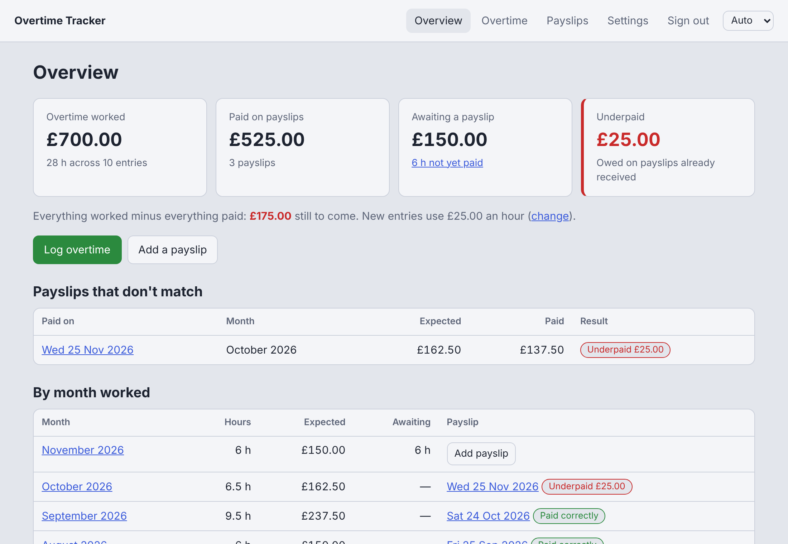
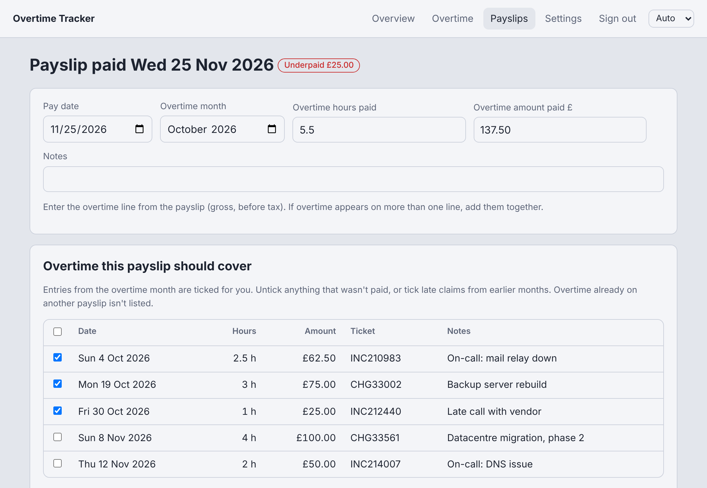
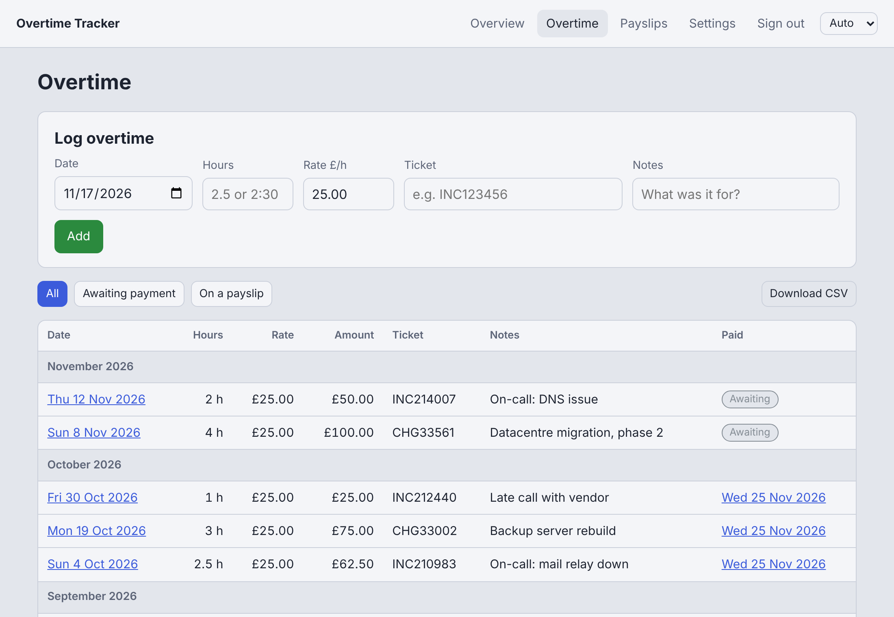

# Overtime Tracker

> [!WARNING]
> **This app was written by AI (Claude) for my own personal use.**
> It has not been professionally reviewed or audited. You're free to use, copy and modify it,
> but **entirely at your own risk**. It comes with no warranty and no support, and I accept no
> responsibility for any data loss, security issues or other problems that result from using it.
> Released under the [MIT License](LICENSE).

A small self-hosted web app for logging overtime and checking that each payslip pays it correctly.



1. **Log overtime** as you work it: date, hours (`2.5` or `2:30`), ticket number and notes.
   Each entry is valued at the hourly rate (£25 by default, changeable in **Settings**).
2. **Add a payslip** when it arrives: the pay date, which month's overtime it covers, and the
   overtime hours and amount it shows. That month's overtime is ticked for you; untick anything
   that wasn't paid, or tick late claims from earlier months.
3. **Check the result.** Each payslip shows *Paid correctly*, *Underpaid £x* or *Overpaid £x*,
   comparing what it paid with the overtime you ticked. The overview adds it all up:
   - **Awaiting a payslip**: overtime not yet on any payslip.
   - **Underpaid / Overpaid**: the total difference on payslips you've already received.
   - **Still to come**: everything worked minus everything paid.

| Payslip | Overtime |
| --- | --- |
|  |  |

Each entry keeps the rate it was logged at, so changing the rate later doesn't change overtime
that's already been paid. Both lists can be downloaded as CSV from **Settings**.

## Run it

```bash
docker run -d --name overtime-tracker -p 7391:7391 -v overtime-tracker:/data -e TZ=Europe/London -e APP_USERNAME=me -e APP_PASSWORD=pick-a-password --restart unless-stopped ghcr.io/elliottmarter/overtime-tracker:latest
```

Change the username and password first, or leave both out to run without a login. Then open
<http://localhost:7391> (or `http://<server-ip>:7391`) and log in. Images are published for
`amd64` and `arm64`.

Or with Docker Compose, using the [docker-compose.yml](docker-compose.yml) in this repo (set
`APP_USERNAME` and `APP_PASSWORD` in it if you want a login):

```bash
docker compose up -d
```

Data lives in `/data/overtime.db` (SQLite) inside the container, so keep `/data` on a volume or host folder.

### On Unraid

1. Open the Unraid terminal (`>_` icon, top right) and download the template:

   ```bash
   wget -O /boot/config/plugins/dockerMan/templates-user/my-overtime-tracker.xml https://raw.githubusercontent.com/elliottmarter/overtime-tracker/main/unraid/overtime-tracker.xml
   ```

2. Go to **Docker → Add Container**, pick **overtime-tracker** from the *Template* dropdown,
   optionally choose a **Username** and **Password** (set both for a login, or leave both empty),
   check the other settings and click **Apply**.
3. Open `http://<unraid-ip>:7391`.

Data is stored in `/mnt/user/appdata/overtime-tracker/data`, so appdata backups include it. Unraid
shows when a new version is available; click **Update** on the container to get it.

### Updating

```bash
docker pull ghcr.io/elliottmarter/overtime-tracker:latest
docker rm -f overtime-tracker
```

then run the `docker run` command again (your data stays in the volume). With Compose:
`docker compose pull && docker compose up -d`.

Version tags such as `:1.0.0` are published for tagged releases, if you'd rather pin a version.

### Settings (environment variables)

| Variable | Default | Purpose |
| --- | --- | --- |
| `TZ` | `UTC` | Time zone used for today's date when logging overtime |
| `APP_USERNAME` | *(unset)* | Username for the web UI login |
| `APP_PASSWORD` | *(unset)* | Password for the web UI login. Set both to require a login, or neither to run without one |
| `PUID` / `PGID` | `1000` / `1000` | User and group the app runs as; `/data` is chowned to them on start (Unraid: `99` / `100`) |

The hourly rate is set in the app under **Settings**, not here.

With a username and password set, you sign in on the app's own login page and stay signed in on that browser for 30 days, or until you
click **Sign out** or change the username or password. The login isn't encrypted on its own, so keep
the port on your LAN or put it behind a reverse proxy with HTTPS. Without them, anyone who can reach
the port can see and change your data, so only do that on a network you trust.

## Build from source

```bash
docker build -t overtime-tracker .
```

Or without Docker:

```bash
pip install -r requirements.txt
DATABASE_PATH=./data/overtime.db APP_USERNAME=me APP_PASSWORD=pw python app/app.py
```

Every push to `main` builds and publishes `:latest` via GitHub Actions
([workflow](.github/workflows/docker.yml)); pushing a tag like `v1.2.0` also publishes `:1.2.0` and `:1.2`.
